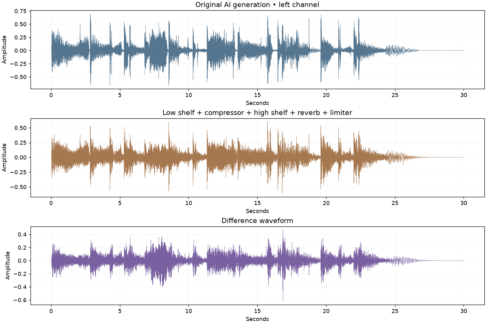

# Phase 1 실제 검증 보고서

> 후속 사용자 청취에서 펑키 디스코 요청의 스타일·리듬 불일치가 확인되었습니다. 아래 완료 표는 엔진·연동·파일 검증이며 음악 품질 합격을 뜻하지 않습니다. [수정 및 재생성 기록](QUALITY_FIX.md).

검증일: 2026-11-15 생성 / 2026-11-16 DSP·MCP·브라우저 최종 QA. 장비: Apple M5 / RAM 24 GiB / macOS 26.2.

## A. 실제 개발 완료 항목

| 완료 기준 | 상태 | 증거 |
|---|---|---|
| 로컬 AI 음악 생성 | **성공** | 실제 ACE-Step Turbo 추론 A/B/C 및 MCP 15초 생성 |
| 서로 다른 프롬프트 | **성공** | Trip-Hop / Ambient / House 각 30초 |
| 유효한 WAV 저장 | **성공** | 48 kHz, stereo, 1,440,000 frames, NaN/Inf·클리핑 0 |
| EQ 적용 및 검증 | **성공** | Low Shelf / High Shelf / Peaking의 파형 차이 및 주파수 응답 검사 |
| 컴프레서·리버브 적용 | **성공** | 생성 원본에 각각 처리, 차이 RMS·채널·길이 확인 |
| 원본과 수정본 별도 저장 | **성공** | 원본 SHA-256 불변, outputs/processed의 새 파일 |
| Codex MCP 호출 | **성공** | 실제 Codex app-server MCP 클라이언트의 9개 도구 호출 |
| 재생 및 A/B 비교 | **성공** | 브라우저 3곡 재생, 4.09초 위치에서 A→B 전환 |
| 자동화 테스트 | **성공** | 24 passed in 2.20s; Ruff 검사 통과 |
| 재실행·설치 방법 문서화 | **성공** | README, 격리 설치 스크립트, 잠금 의존성, .env.example |

CLI·플레이어·MCP가 동일한 핵심 엔진을 호출한다. 생성 동시 작업 1개, request key 중복 방지, 타임아웃, 자식 메모리 감시, 경로 경계, 원본 보존과 복원 기능을 포함한다. 자연어 명령은 검증된 파라미터로 변환되며 임의 코드를 실행하지 않는다.

## B. 음악 생성 결과

모델: **ACE-Step 1.5 2B Turbo**. 공식 소스 `ca1e85fe9430179831e6bc6be790c332190a3866`, 공식 가중치 `19671f406d603126926c1b7e2adc169acbcade22`. MLX 4-bit DiT + MPS bf16 conditioning / tiled VAE. 외부 음악 생성 API, 예제 음원, 대체 임의 파형을 사용하지 않았다.

| 테스트 | 길이 | 총 소요 시간 | worker 시간 | 최대 자식 footprint | 브라우저 재생 |
|---|---:|---:|---:|---:|---|
| A | 30초 | 69.132초 | 62.063초 | 7.861 GiB | 성공 |
| B | 30초 | 27.998초 | 23.054초 | 5.011 GiB | 성공 |
| C | 30초 | 28.650초 | 23.543초 | 5.003 GiB | 성공 |

### TEST A

> 90년대 트립합 느낌의 어두운 음악. 85BPM, 묵직한 드럼과 깊은 베이스, 몽환적인 신스. 보컬 없는 30초 음악.

- Version: `f420154cf3e54b63ab2a1050d2c87a0e`
- WAV: [ca68402a-de9e-975a-74a1-63a215775052.wav](</path/to/local-ai-music-studio/outputs/originals/46dd7d3dce5b48a5a80c785e3108e691/ca68402a-de9e-975a-74a1-63a215775052.wav>)
- Seed: 42; caption BPM: 85

### TEST B

> 우주를 떠다니는 듯한 고요한 앰비언트 음악. 천천히 변화하는 패드, 긴 잔향, 드럼 없음.

- Version: `f50caa03a04147c59e9a15a3024a9691`
- WAV: [1d239f77-9ffc-14f3-b857-dedb99f75c50.wav](</path/to/local-ai-music-studio/outputs/originals/36f66d80f6f34d09a02602355191dd15/1d239f77-9ffc-14f3-b857-dedb99f75c50.wav>)
- Seed: 43; caption BPM: 60

### TEST C

> 따뜻한 딥하우스 음악. 단단한 킥, 반복적인 신스 베이스, 부드러운 코드 진행.

- Version: `0edf0c8408d244bf8aa229f658ba04ab`
- WAV: [6b385576-14a1-fb18-0f7a-58cc2586d565.wav](</path/to/local-ai-music-studio/outputs/originals/2267a7d5319144f9873b7d1c1fe54bf8/6b385576-14a1-fb18-0f7a-58cc2586d565.wav>)
- Seed: 44; caption BPM: 120

A는 최초 MLX 변환 비용을 포함한다. B/C는 로컬 캐시를 재사용한다. 파형 유효성과 실제 브라우저 디코딩/재생을 검증했다. 요청한 장르·BPM을 청감상 얼마나 정확하게 따르는지는 별도 청취 평가 대상이며 수치 검사로 합격 처리하지 않았다.

추가 STDIO MCP 테스트: 15초 앰비언트, seed 45, 총 35.062초, peak footprint 4.672 GiB. 새 생성에 성공했다. [생성 원본 기록](generation-results.json), [추가 MCP 생성 기록](mcp-smoke.json).

## C. DSP 비교 결과

| 개별 효과 | 수정본 peak dBFS | 차이 RMS | 저역 power 비율 | 고역 power 비율 |
|---|---:|---:|---:|---:|
| eq low_shelf | -1.000 | 0.047803 | 1.831× | 0.999× |
| eq high_shelf | -1.937 | 0.004494 | 1.000× | 0.502× |
| eq peaking | -2.064 | 0.009667 | 0.994× | 0.988× |
| compressor | -3.443 | 0.062218 | 0.192× | 0.399× |
| reverb | -3.158 | 0.062692 | 0.751× | 0.615× |
| distortion | -8.508 | 0.031988 | 1.060× | 0.292× |
| limiter | -6.000 | 0.013799 | 0.843× | 0.683× |

개별 효과 검사에서 limiter 외 체인은 마지막에 -1 dBFS limiter를 추가해 과부하를 막았다. 모든 파일은 원본과 같은 48 kHz / stereo / 30초이며, 유한 샘플과 클리핑 0을 확인했다. 효과에 따른 실제 샘플 변화도 확인했다.

자연어: “베이스를 좀 더 묵직하게, 조금 더 몽환적으로 만들어줘.” → low shelf +4 dB @110 Hz → compressor → high shelf -3 dB @5 kHz → reverb wet 0.28 → limiter -1 dBFS.

- [원본 WAV](</path/to/local-ai-music-studio/outputs/originals/46dd7d3dce5b48a5a80c785e3108e691/ca68402a-de9e-975a-74a1-63a215775052.wav>)
- [자연어 수정 WAV](</path/to/local-ai-music-studio/outputs/processed/dff5c3cd13184675a41ef984ab6ae451.wav>)
- 차이 RMS: 0.072047; 바뀐 샘플 2,879,961개.
- Peak: -1.000 → -3.393 dBFS. 전체 체인의 컴프레서로 절대 저역 power는 감소할 수 있으므로 저역 boost 효과는 위 개별 EQ 검사와 구분한다.
- 원본 SHA-256: `631a59cae89640d9072a898fefdf2f529896eaa0a6a68a7eea98669b0ec16e86` (처리 이후 재검증).



[전체 효과·파일·분석 기록](audio-qa.json).

## D. MCP 및 플레이어 연결 결과

프로젝트 `.codex/config.toml`만 등록했다. 이전 파일이 없었음을 `.runtime/backups/codex-config-20261116-225603-002867.absent.txt`에 백업 기록했다. 사용자 전역 설정은 수정하지 않았다. `codex mcp get local_music`으로 STDIO 설정을 확인했다.

실제 설치된 Codex app-server를 띄워 `mcpServer/tool/call`을 호출했다. 임시 프로토콜 세션만 사용했고 LLM turn이나 별도 에이전트는 실행하지 않았다. SDK의 새 생성 성공 후, Codex `music.generate`는 같은 request key를 재호출하여 기존 성공 작업이 반환됨을 검증했다. 이 두 결과를 새로운 두 곡 생성으로 중복 계산하지 않았다.

```text
CODEX MCP music.generate SUCCESS (isError=false)
CODEX MCP music.get_status SUCCESS (isError=false)
CODEX MCP music.list_versions SUCCESS (isError=false)
CODEX MCP music.apply_effect SUCCESS (isError=false)
CODEX MCP music.render SUCCESS (isError=false)
CODEX MCP music.produce SUCCESS (isError=false)
CODEX MCP music.compare SUCCESS (isError=false)
CODEX MCP music.export SUCCESS (isError=false)
CODEX MCP music.restore SUCCESS (isError=false)
```

[Codex 실제 요청·응답](codex-mcp-calls.json) · [STDIO SDK 요청·응답](mcp-smoke.json). 이미 열린 채팅의 도구 목록 자동 갱신은 미검증이며 새 프로젝트 대화에서 사용한다.

브라우저 실제 검사: A 재생 시각 4.062초 → 전환 후 A 일시중지 4.090초 / B 재생 4.332초. Ambient는 13.102초 재생 상태, House는 30초 종료 상태를 관찰했다. 모두 duration 30초, 오디오 오류 없음. 자연어 수정본 생성, 분석 비교, A 복원, WAV export 성공. 콘솔 오류 0. [재생 증거](browser-qa.json).

플레이어 검증 화면은 로컬 QA 자료로 보관합니다.

## E. 실행 방법

```bash
cd '/path/to/local-ai-music-studio'
.venv/bin/music player
.venv/bin/music generate '우주 앰비언트, 드럼 없음, 보컬 없는 30초 음악.' --seed 48 --wait
.venv/bin/music produce f420154cf3e54b63ab2a1050d2c87a0e '조금 더 몽환적으로 만들어줘.'
.venv/bin/python -m pytest -q
```

[플레이어](http://127.0.0.1:8795) · [설치·전체 CLI 설명](../README.md). 현재 플레이어는 8795에서 실행 중이다. 재설치는 `./scripts/install.sh`; 다운로드 뒤 추론은 오프라인이다. 격리 환경 설치는 수행했으나 다른 깨끗한 장비에서의 설치 재현은 미검증이다.

## F. 남은 문제 및 다음 우선순위

| 항목 | 상태 | 설명 |
|---|---|---|
| 초기 MPS-only 실행 | 실패 후 해결 | float32 10 GiB 제한, bf16 critical pressure로 중단. 기본 MLX 4-bit 구성에서 성공. 실패 기록은 이력에 보존. |
| 16 GiB 장비 / CPU-only | 미검증 | 실제 검증 장비는 M5 24 GiB. 다른 작업 부하에 따라 안전 중단 가능. |
| 청감 품질·프롬프트 충실도·보컬 | 미검증 | 파일/재생/파형 검증과 구분. 생성곡 직접 청취 및 보컬 전용 QA가 다음 과제. |
| 멜로디·악기 교체·멀티트랙 편곡 | 미구현 | requires_regeneration으로 명확히 반환. 스템 분리·재생성 워크플로는 후속 단계. |
| True-peak / 리버브 꼬리 | 제한 | 샘플 피크 limiter. 원본 길이 유지를 위해 끝의 리버브 꼬리 절단. |
| 완전 새 장비의 설치 | 미검증 | 현재 장비 격리 설치 성공. 잠금 파일·스크립트 제공. |
| 상용 패키징 | 미검증 | LGPL/MPL 및 네이티브 wheel 고지 검토 필요. [라이선스 목록](LICENSES.md). |

후속 우선순위: 생성곡 청취 평가 → 16 GiB 메모리 프로파일과 보컬 QA → 스템/재생성 워크플로. 이번 단계의 로컬 생성·DSP·MCP·재생 프로토타입 완료 기준은 위 표와 같이 성공했다.
