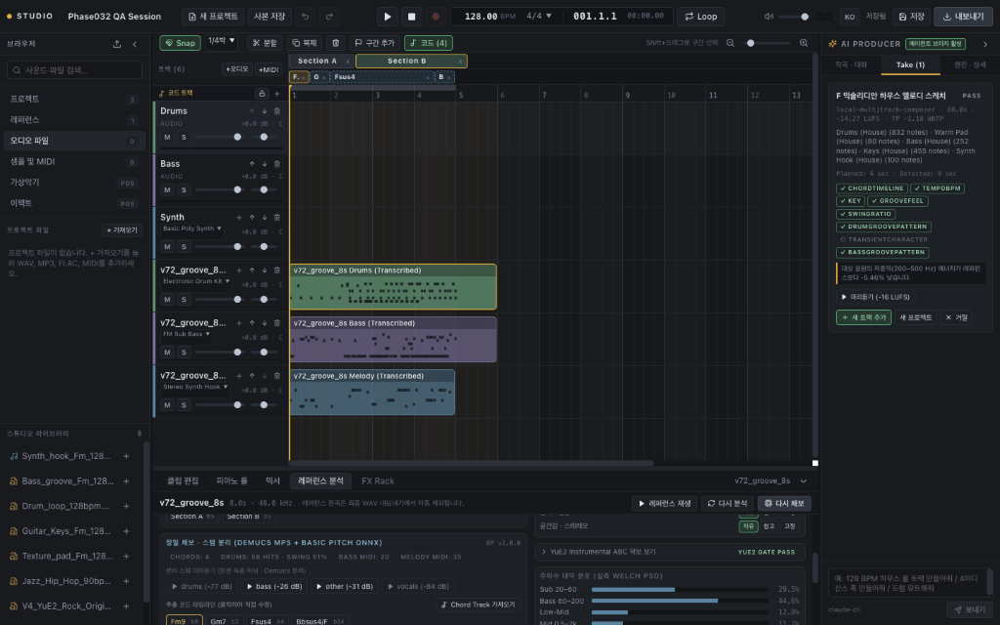
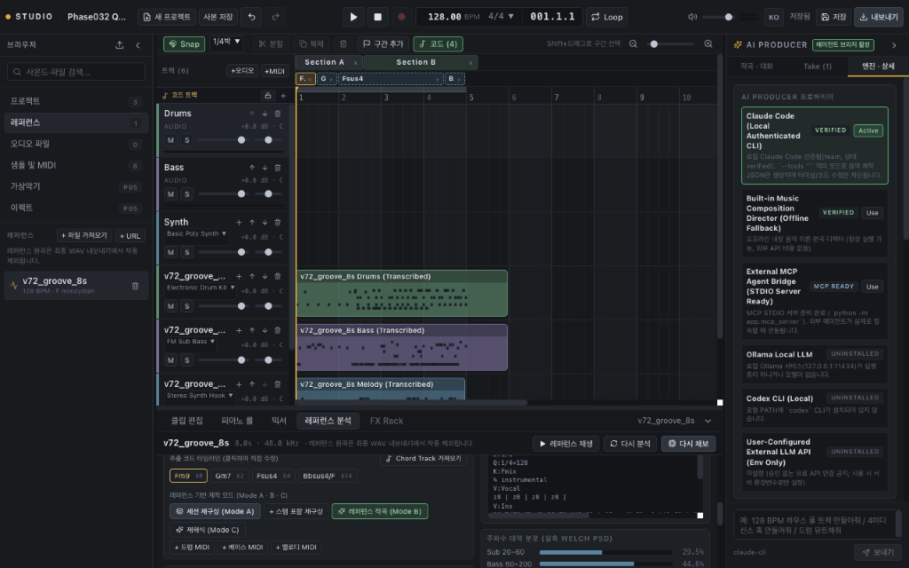

# PHASE 03.2 · ADVANCED REFERENCE INTELLIGENCE
## Music Transcription · Reference Reconstruction · Reference-Conditioned Composition

**Branch:** `feat/daw-advanced-reference-intelligence` (stacked on `feat/daw-phase-04-arrangement` PR #22)  
**Schema Version:** `1.4.0`  
**Status:** Complete & Verified on Real Studio Audio + Live Browser QA

---

## 1. Installed & Verified Local Engines (GATE 1)

| Engine | Version / Weights | License | Runtime State | Verified Benchmark (Apple M1 16 GiB) |
|---|---|---|---|---|
| **Spotify Basic Pitch ONNX** | `0.4.0` + `onnxruntime 1.32.0` (`nmp.onnx`, 0.23 MB) | Apache-2.0 | `verified` | 96s V7.2 master → 484 MIDI notes in `2.20s` (`312 MB RSS`, zero TF/FFmpeg) |
| **Demucs (`htdemucs`)** | `4.1.0` + PyTorch MPS (`80.2 MB` checkpoint) | MIT | `verified` | 10s studio excerpt → 4 stems (`drums`, `bass`, `other`, `vocals`) in `6.05s` (`524 MB RSS`, `soundfile` runner, zero FFmpeg) |
| **Multi-Band Drum & Groove** | Built-in (`drum_transcriber.py`) | MIT | `verified` | Kick/Snare/CH/OH/Perc raw + quantized MIDI, swing, microtiming ms, 2-bar template |
| **Viterbi Sub-bar Chord Tracker** | Built-in (`chord_tracker.py`) | MIT | `verified` | 2-beat slice chord + slash-bass inversion extraction across 84 chord templates |
| **SheetSage2** | `m-a-p/SheetSage2` | **CC BY-NC 4.0** | `uninstalled` | Honestly reported uninstalled (non-commercial + ~3 GiB `MERT-v2`); YuE2 ABC builder (`sheetsage_adapter.py`) produces validated instrumental ABC passing `check_resting_voice()` |
| **YourMT3+ / All-In-One** | External multi-GB checkpoints | Research / MIT | `uninstalled` | Honestly reported uninstalled; native Demucs stem-energy Arrangement Map + Demucs-guided Basic Pitch handles transcription |

## 2. Implemented Capabilities

1. **Precision Reference Transcription (`engine/transcription/`):**
   - Sequential Apple Silicon execution with content-addressed caching (`cache/transcription/` and `cache/stems/`).
   - Strict separation between **Measured**, **Estimated**, and **User-Corrected** values.
   - `Other` stem is never falsely labeled as a single isolated instrument; separated stems carry explicit `assetKind: "separated_stem"` provenance.
2. **Editable Timeline Chord Track (`Schema 1.4.0`):**
   - `project.chordTrack` (`ChordEvent[]` supporting fractional sub-bar `startBeat` / `endBeat`, `bassNote`, `confidence`, `isEstimate`, `userCorrected`, `locked`) and `project.chordTrackLocked`.
   - Shared commands `chord.setTrack`, `chord.upsert`, `chord.delete`, `chord.setLocked` mirrored in Python & TypeScript.
   - 22px Timeline Chord Track strip in `ArrangementTimeline.tsx` with inline chord editing & lock toggle.
3. **Reference Blueprint v2 & 10-Feature Lock Matrix:**
   - 10 canonical features (`bpm`, `beat_grid`, `chord_progression`, `drum_rhythm`, `bass_groove`, `melody`, `instrumentation`, `arrangement`, `timbre`, `spatial_character`) with `free | reference | locked | unsupported` states and honest pre-generation capability validation (`validate_feature_locks_for_engine`).
4. **3 Reference Production Modes + Post-Generation 5-State Verification:**
   - **Mode A (`Reconstruct`):** Imports Chord Track, Arrangement Markers, Drums/Bass/Melody MIDI, and optional Demucs `type="stem"` tracks with 1-click Undo; original Reference audio stays excluded from Stereo WAV exports.
   - **Mode B (`Reference Compose`):** Locks chosen reference BPM, sub-bar Chord Timeline, and Drum/Bass Groove templates while composing fresh melodies; post-generation verification measures exact `chordMatchRatio` and `grooveHitMatchRatio` and marks unconsumed MIDI features (`stereoWidthTarget`, `spectralCentroidTargetHz`) honestly as `consumed: false, verified: false`.
   - **Mode C (`Reinterpret`):** Preserves harmonic/structural blueprint while generating new style/melody direction & validated YuE2 instrumental ABC score.
5. **7 New REST Endpoints & 7 New MCP Tools (68 Tools Total):**
   - REST: `POST /references/{ref_id}/transcribe`, `GET /references/{ref_id}/stems/{role}/audio`, `PATCH /references/{ref_id}/locks`, `POST /references/{ref_id}/reconstruct`, `GET /references/{ref_id}/abc`, `GET/PUT /chords`.
   - MCP: `daw.transcribe_reference`, `daw.get_chord_track`, `daw.set_chord_track`, `daw.update_reference_locks`, `daw.import_reference_transcription`, `daw.reconstruct_from_reference`, `daw.get_reference_abc_score`.

## 3. Verification Results

- **Backend `pytest -q`:** `69 passed` (including `tests/test_phase032_advanced_reference.py` covering real-audio **TEST A–E** + real V7.2 studio excerpt transcription + 68 MCP tools).
- **Frontend `vitest` + `vite build`:** `13 passed` + clean production build.
- **Live Browser QA (`1440×900` & `1280×800`):** `0` console errors, `0` failed HTTP requests, `0` horizontal overflow.
  - 
  - 
